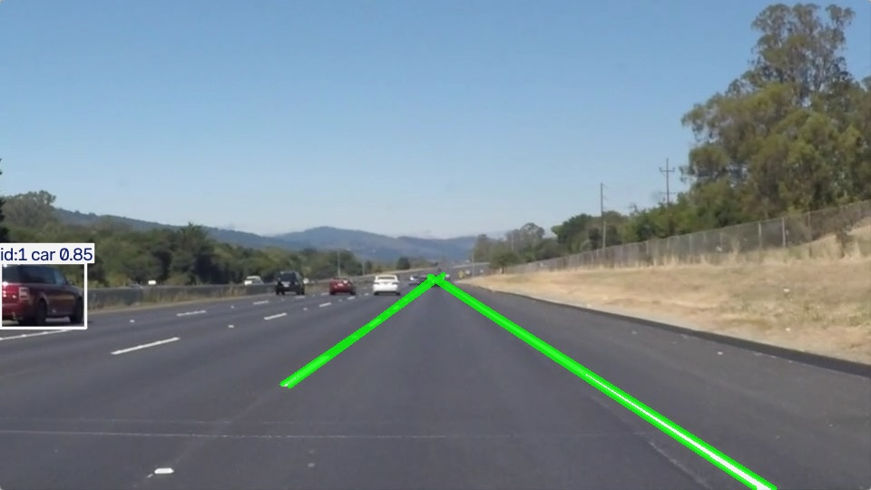
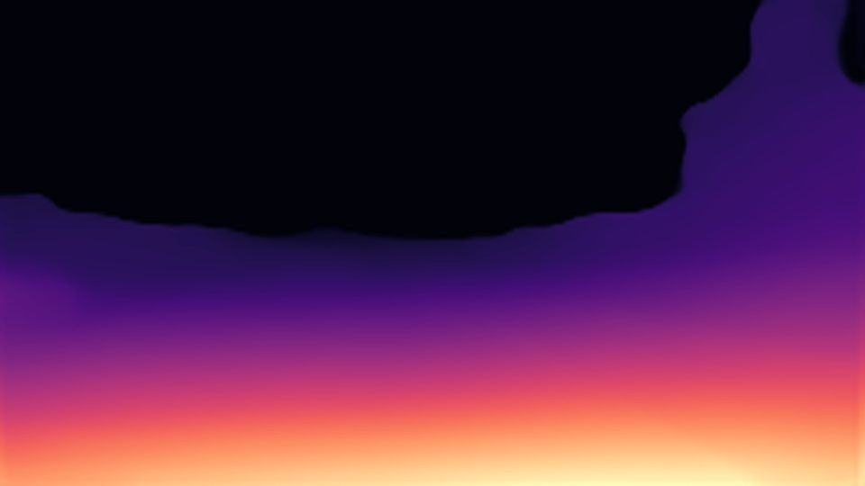
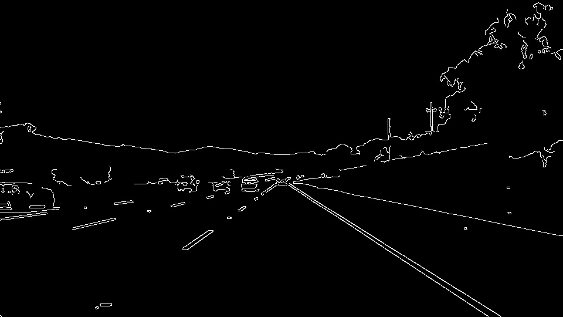

# 🚗 Autonomous Driving Perception Stack

An AI-powered autonomous driving perception system using Computer Vision and Deep Learning to understand road environments through object detection, lane detection, lane segmentation, object tracking and depth estimation.

## 📌 Project Overview

The Autonomous Driving Perception Stack is a computer vision and deep learning-based project designed to analyze road environments and identify important driving information.

The system integrates multiple perception modules to process road images and videos, detect vehicles, identify lane markings, track objects and estimate relative scene depth.

## 🎯 Project Objectives

- Detect vehicles and other road objects using YOLOv8.
- Identify road lanes using computer vision techniques.
- Perform road segmentation.
- Estimate relative depth using MiDaS.
- Track detected objects across video frames.
- Integrate multiple perception modules into a unified pipeline.
- Evaluate model performance and support ONNX model export.

## 🛠️ Technologies Used

| Technology | Purpose |
|---|---|
| Python | Programming language |
| OpenCV | Image processing |
| NumPy | Numerical operations |
| PyTorch | Deep learning |
| YOLOv8 | Object detection |
| MiDaS | Depth estimation |
| ONNX | Model optimization and inference |
| Matplotlib | Visualization |
| PyTest | Automated testing |
| Git & GitHub | Version control |

## 📂 Project Structure

```text
Autonomous-Driving-Perception/
│
├── datasets/
│   ├── bus.jpg
│   └── road.jpg
│
├── docs/
├── models/
│   └── yolov8n.onnx
│
├── outputs/
│   ├── benchmark/
│   ├── depth_estimation/
│   ├── integrated_pipeline/
│   ├── lane_detection/
│   ├── lane_segmentation/
│   ├── object_detection/
│   ├── object_tracking/
│   └── screenshots/
│       ├── perception_result.jpg
│       ├── depth_result.jpg
│       ├── lane_result.jpg
│       └── edge_result.jpg
│
├── simulator/
│   ├── docs/
│   ├── outputs/
│   ├── recordings/
│   └── src/
│       ├── perception_pipeline.py
│       └── video_simulator.py
│
├── src/
│   ├── depth_estimation/
│   ├── lane_detection/
│   ├── lane_segmentation/
│   ├── object_detection/
│   ├── object_tracking/
│   ├── optimization/
│   └── pipeline.py
│
├── tests/
│   └── test_pipeline.py
│
├── requirements.txt
├── yolov8n.pt
├── yolov8n.onnx
└── README.md
```

## 🧠 Modules Description

### 1. Object Detection
Uses YOLOv8 to detect vehicles and other objects in road images.

### 2. Lane Detection
Uses OpenCV image-processing techniques to identify road lane markings.

### 3. Lane Segmentation
Identifies road regions and lane areas using image segmentation techniques.

### 4. Depth Estimation
Uses MiDaS to estimate relative depth information from a single road image.

### 5. Object Tracking
Tracks detected objects across video frames.

### 6. Video Simulation
Uses webcam or video input to test the perception system.

### 7. Optimization
Includes model benchmarking and ONNX model export functionality.

### 8. Integrated Perception Pipeline
Combines multiple perception modules to generate road-scene analysis results.

## 📸 Project Results

The perception pipeline successfully generated the following outputs.

### 1. Object Detection and Lane Detection



### 2. Depth Estimation



### 3. Lane Detection


### 4. Edge Detection



## ⚡ Model Benchmark Results

The project includes performance benchmarking between PyTorch YOLOv8n and ONNX YOLOv8n.

| Model | Average Latency | FPS |
|---|---:|---:|
| PyTorch YOLOv8n | 109.37 ms | 9.14 |
| ONNX YOLOv8n | 243.51 ms | 4.11 |

**Benchmark Environment:**
- Python: 3.13.5
- PyTorch: 2.15.0+cpu
- Processor: Intel Core i5-7300U 2.60 GHz
- Device: CPU

*Note: These measurements represent the observed performance in this particular CPU environment.*

Benchmark results are saved in:

```text
outputs/benchmark/benchmark_results.csv
```

## 🚀 Installation and Execution

### Step 1: Clone the Repository

```bash
git clone https://github.com/bayyabhavana/Autonomous-Driving-Perception.git
```

### Step 2: Navigate to Project Directory

```bash
cd Autonomous-Driving-Perception
```

### Step 3: Create Virtual Environment

```bash
python -m venv venv
```

### Step 4: Activate Virtual Environment (Windows)

```powershell
venv\Scripts\activate
```

### Step 5: Install Dependencies

```bash
pip install -r requirements.txt
```

### Step 6: Run Perception Pipeline

```bash
python simulator/src/perception_pipeline.py
```

### Step 7: Run Automated Tests

```bash
python -m pytest tests -v
```

### Step 8: Run Benchmark

```bash
python src/optimization/benchmark.py
```

### Step 9: Export YOLOv8 to ONNX

```bash
python src/optimization/export_onnx.py
```

## 🧪 Testing

The project includes automated tests to verify:

- Dataset image availability.
- Image loading functionality.
- Pipeline input validation.

**Test Execution Result:**

```text
4 passed
```

All four implemented test cases passed successfully.

## 📦 Model Information

- Object Detection Model: YOLOv8n
- Depth Estimation Model: MiDaS
- Model Export Format: ONNX
- Inference Runtime: ONNX Runtime
- Execution Device: CPU

## 📁 Output Directory

Generated results are organized under:

- `outputs/` – Module-specific outputs, benchmarks and screenshots.
- `simulator/outputs/` – Integrated perception pipeline results.

## 🔮 Future Enhancements

- Real-time object detection and tracking improvements.
- GPU-based inference acceleration.
- Improved lane detection under different weather conditions.
- Integration with autonomous driving simulators.
- Improved perception accuracy and performance evaluation.

## 🏁 Conclusion

The Autonomous Driving Perception Stack demonstrates the integration of computer vision and deep learning techniques for autonomous driving applications.

The project combines object detection, lane detection, lane segmentation, object tracking and depth estimation into a unified perception workflow.

The integrated pipeline executed successfully, and all four implemented automated tests passed.

## 👩‍💻 Author

**Bhavana Goud**

GitHub: https://github.com/bayyabhavana

**Project Repository:**

https://github.com/bayyabhavana/Autonomous-Driving-Perception

---

⭐ If you find this project interesting, feel free to explore the repository.