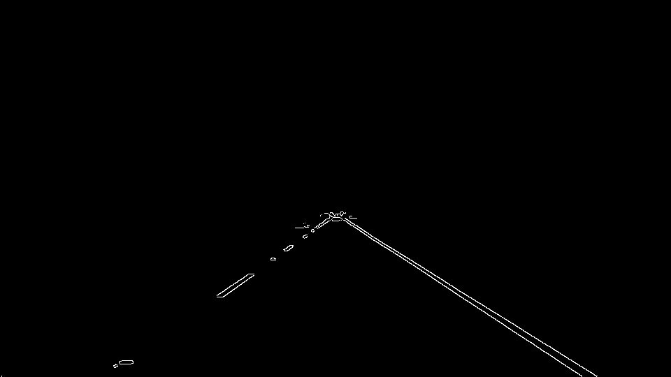

# Autonomous Driving Perception Stack

## Project Overview

The Autonomous Driving Perception Stack is a computer vision and deep learning-based project designed to analyze road environments and identify important driving information.

The system integrates multiple perception modules to process road images and videos, detect vehicles, identify lane markings, and estimate scene depth.

## Project Objectives

- Detect vehicles and other road objects using YOLOv8.
- Identify road lanes using computer vision techniques.
- Perform road segmentation.
- Estimate relative depth using MiDaS.
- Track detected objects across video frames.
- Integrate multiple perception modules into a single pipeline.
- Evaluate model performance and support ONNX model export.

## Technologies Used

- Python
- OpenCV
- NumPy
- PyTorch
- Ultralytics YOLOv8
- MiDaS
- ONNX
- Matplotlib
- PyTest
- Git and GitHub

## Project Structure

```text
Autonomous-Driving-Perception/
│
├── datasets/
│   ├── bus.jpg
│   └── road.jpg
│
├── docs/
│
├── models/
│
├── outputs/
│   ├── benchmark/
│   ├── depth_estimation/
│   ├── integrated_pipeline/
│   ├── lane_detection/
│   ├── lane_segmentation/
│   ├── object_detection/
│   ├── object_tracking/
│   └── screenshots/
│       ├── perception_result.jpg
│       ├── depth_result.jpg
│       ├── lane_result.jpg
│       └── edge_result.jpg
│
├── simulator/
│   ├── docs/
│   ├── outputs/
│   ├── recordings/
│   └── src/
│       ├── perception_pipeline.py
│       └── video_simulator.py
│
├── src/
│   ├── depth_estimation/
│   ├── lane_detection/
│   ├── lane_segmentation/
│   ├── object_detection/
│   ├── object_tracking/
│   ├── optimization/
│   └── pipeline.py
│
├── tests/
│   └── test_pipeline.py
│
├── requirements.txt
├── yolov8n.onnx
├── yolov8n.pt
└── README.md
```

## Modules Description

### 1. Object Detection

Uses YOLOv8 to detect vehicles and other objects in road images.

### 2. Lane Detection

Uses OpenCV image-processing techniques to identify road lane markings.

### 3. Lane Segmentation

Identifies road regions and lane areas using image segmentation techniques.

### 4. Depth Estimation

Uses MiDaS to estimate relative depth information from a single road image.

### 5. Object Tracking

Tracks detected objects across video frames.

### 6. Video Simulation

Uses a webcam or video input to test the perception system.

### 7. Optimization

Includes benchmarking and ONNX model export functionality.

### 8. Integrated Perception Pipeline

Combines multiple perception modules to generate road-scene analysis results.

## Project Results

The perception pipeline successfully generated the following outputs.

### 1. Object Detection and Lane Detection


### 2. Depth Estimation


### 3. Lane Detection



### 4. Edge Detection


## Execution Steps

### Step 1: Clone the Repository

```bash
git clone https://github.com/bayyabhavana/Autonomous-Driving-Perception.git
```

### Step 2: Navigate to Project Directory

```bash
cd Autonomous-Driving-Perception
```

### Step 3: Create Virtual Environment

```bash
python -m venv venv
```

### Step 4: Activate Virtual Environment (Windows)

```powershell
venv\Scripts\activate
```

### Step 5: Install Dependencies

```bash
pip install -r requirements.txt
```

### Step 6: Run Perception Pipeline

```bash
python simulator/src/perception_pipeline.py
```

### Step 7: Run Tests

```bash
python -m pytest tests -v
```

## Testing

The project includes automated tests to verify:

- Dataset image availability.
- Image loading functionality.
- Pipeline input validation.

The current test execution completed successfully with **4 passed test cases**.

## Model Information

- Object Detection Model: YOLOv8n
- Depth Estimation Model: MiDaS
- Model Export Format: ONNX

## Output Directory

All generated outputs are organized under the `outputs/` and `simulator/outputs/` directories.

## Conclusion

The Autonomous Driving Perception Stack demonstrates the integration of computer vision and deep learning techniques for autonomous driving applications.

The project combines object detection, lane detection, lane segmentation, object tracking, and depth estimation into a unified perception workflow.

## Author

**Bhavana Goud**

GitHub: https://github.com/bayyabhavana

Project Repository: https://github.com/bayyabhavana/Autonomous-Driving-Perception
